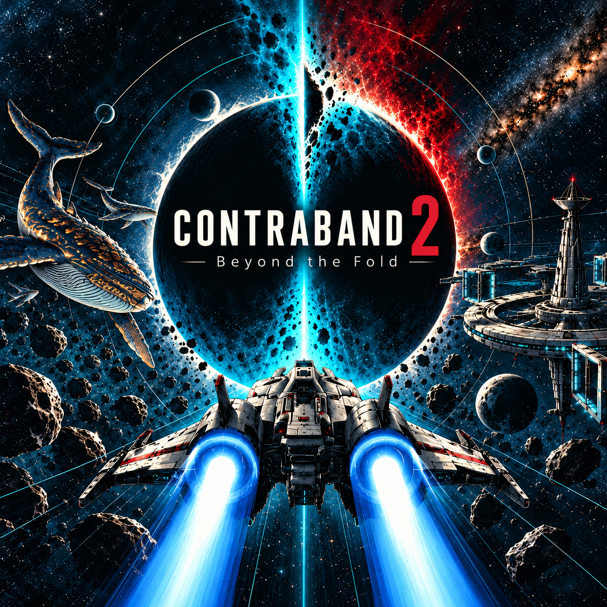
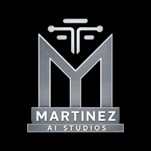

# MAS CONTRABAND Presence — public assets

Selected promotional artwork and official Martinez AI Studios logo animation for Discord Rich Presence.

## Contraband 2 — Beyond the Fold

Selected by the owner; square adaptation of La señal using the built-in image generation editor. 1254 × 1254 PNG. Use as `assets.large_image`:
https://raw.githubusercontent.com/DeroLavigne/mas-contraband-presence-assets/main/contraband2-senal-square-v1.png

SHA-256: `7689cb3cc141b064cb8e44c97a76445f68ad41ca341bf7c27cc356119fd2fdf1`.

## Studio logo

Use as `assets.small_image`:
https://raw.githubusercontent.com/DeroLavigne/mas-contraband-presence-assets/main/mas-logo-spin-v1.gif

256 × 256 pixels, 20 FPS, 5-second infinite loop, black background; original 3D logo and animation with frontal pause. 925793 bytes. SHA-256: `36a6a73692a14be805596eef5c4d503835c764531840ade062ab10c4d268a136`.

Uploaded Developer Portal assets do not preserve animation; external GIF URLs are supported. Rendering depends on the Discord client and viewer settings.

Only promotional image assets are published here. No application credentials, configuration, game source code, or private project files are included. Public availability does not grant a trademark or redistribution license.
